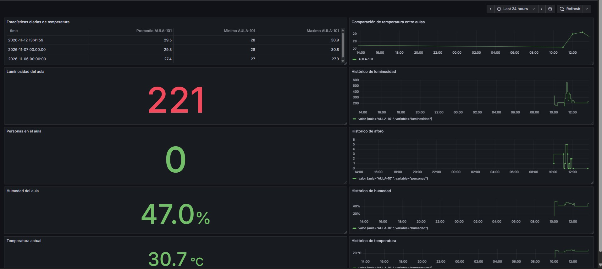

# Sistema IoT para el control de entradas y salidas en aulas de clase

## Semana 15 — Visualización histórica y alertas dinámicas

**Unidades Tecnológicas de Santander (UTS)**  
**Asignatura:** Internet de las Cosas (IoT) — **Grupo:** B192  
**Integrantes:** Kevin David Aljuri Moncada y Diana Marcela Beltrán Suárez  
**Año:** 2026

## 1. Descripción

En la semana 13 se implementó el monitoreo y control de un aula con ESP32, sensores y Adafruit IO. En la semana 14 se agregó Python e InfluxDB para almacenar el histórico de temperatura, humedad, luminosidad y personas. En la **semana 15** se consolidó el dashboard de Grafana, se añadió un selector de aula, se organizó la comparación de sesiones y se comprobó una alerta dinámica mediante una simulación de temperatura alta.

Se conservó el funcionamiento de los sensores infrarrojos, el DHT11, el LDR, los LED y el buzzer. El flujo del sistema es:

**ESP32 → Adafruit IO (MQTT) → Python → InfluxDB → Grafana → Gmail**

## 2. Dashboard de Grafana

El dashboard **Control Inteligente de Aula B192** contiene los siguientes elementos:

- Indicadores actuales de temperatura, humedad, luminosidad y personas.
- Tendencias de temperatura y luminosidad de las últimas 24 horas.
- Gráficas históricas complementarias de humedad y aforo.
- Comparación de dos series etiquetadas como **AULA-101** y **AULA-102**.
- Estadísticas diarias: promedio, mínimo y máximo de temperatura.
- Selector interactivo `aula`, para cambiar de sesión sin editar cada consulta.
- Gauge con colores verde, amarillo y rojo según la diferencia frente al umbral estadístico.

> **Aclaración:** las dos etiquetas corresponden a sesiones de medición con el mismo prototipo. No se afirma que se hayan monitoreado dos aulas físicas simultáneamente.



### Comparación y estado dinámico


El Gauge representa **exceso = temperatura actual − umbral dinámico**, no la temperatura ambiente. Un resultado negativo indica que todavía no se ha alcanzado el límite. Los colores se configuraron como: verde para valores inferiores a −2 °C, amarillo entre −2 °C y 0 °C y rojo desde 0 °C.


## 3. Umbral dinámico y alertas

El archivo `alertas.py` del proyecto de la semana 14 consulta las temperaturas históricas almacenadas en InfluxDB y calcula un límite estadístico:

**Umbral dinámico = promedio histórico + 2 × desviación estándar**

Después calcula el exceso y Grafana evalúa si ese valor es mayor que cero. Se conservaron reglas de temperatura, humedad, luminosidad y aforo, con notificaciones a Gmail.


### Prueba controlada de semana 15

Se utilizó el archivo `simulacion_s15.py` y un bucket separado llamado `aulas_prueba_s15`, con la etiqueta `SIM-S15`, para no mezclar datos de prueba con mediciones reales.

La prueba generó 25 temperaturas de referencia y una lectura simulada de **40 °C**. Se obtuvo:

| Dato | Resultado |
|---|---:|
| Promedio | 27,60 °C |
| Desviación estándar | 0,42 °C |
| Umbral dinámico | 28,45 °C |
| Temperatura simulada | 40,00 °C |
| Exceso | +11,55 °C |

**Importante:** en esta prueba aislada el umbral se calculó primero en Python sobre los valores simulados y luego se escribió en InfluxDB. En cambio, el script habitual `alertas.py` utiliza el histórico ya almacenado en InfluxDB. Son procedimientos distintos y se documentan como tales.


La regla **PRUEBA S15 - Temperatura simulada** alcanzó el estado *Firing* y se recibió un correo de Grafana.


## 4. Integración y persistencia del proyecto

Se mantuvo el almacenamiento local desarrollado en la semana 14. Python obtiene las cuatro variables desde Adafruit IO y las guarda en el bucket `aulas`. Los volúmenes de Docker conservan el histórico al reiniciar InfluxDB.


## 5. Cómo volver a abrir el proyecto (sin reinstalar)

Desde la carpeta operativa de la **semana 14**, donde se encuentra `compose.yaml`, abrir Docker Desktop y ejecutar:

```powershell
docker compose up -d
docker compose ps
```

Con el ESP32 conectado y publicando en Adafruit IO, iniciar la sincronización:

```powershell
.\.venv\Scripts\python.exe scripts\ejecutar.py
```

Consultar Grafana en **http://localhost:3000** e InfluxDB en **http://localhost:8086**. Para detener: `Ctrl + C` en Python y después `docker compose stop`. No usar `docker compose down -v`, porque elimina los volúmenes.

## 6. Archivos y organización

- `docs/`: las 13 capturas utilizadas en el informe de semana 15.
- `scripts/simulacion_s15.py`: simulación independiente de 40 °C.
- `dashboards/dashboard_grafana.json`: exportación final del dashboard de Grafana (**añadir este archivo antes de publicar**).
- Los archivos de operación `ingesta.py`, `comun.py`, `ejecutar.py`, `alertas.py` y `compose.yaml` se mantienen en [proyecto-iot-semana14](../proyecto-iot-semana14/), sin duplicarlos ni sustituirlos.

## 7. Dificultades y limitaciones

El prototipo utiliza un solo ESP32 y la comparación se construyó con dos sesiones de medición etiquetadas. Las lecturas iniciales atípicas y los posibles cortes de WiFi deben tenerse en cuenta al interpretar estadísticas y alertas. Si el script de Python no produce un cálculo reciente, el Gauge puede mostrar *No data* aunque el histórico permanezca guardado. La luminosidad procede de la lectura ADC del LDR y no corresponde a lux calibrados.

## 8. Conclusión

En esta semana se aprovechó InfluxDB para visualizar el comportamiento histórico en Grafana, utilizar un selector de aula, consultar estadísticas y representar el estado dinámico mediante un Gauge. La simulación de una temperatura alta permitió comprobar que Grafana detecta una condición anormal y envía una notificación por Gmail, sin modificar las mediciones reales.

## Referencias

- [Adafruit IO](https://io.adafruit.com/)
- [InfluxDB 2](https://docs.influxdata.com/influxdb/v2/)
- [Grafana](https://grafana.com/docs/grafana/latest/)
