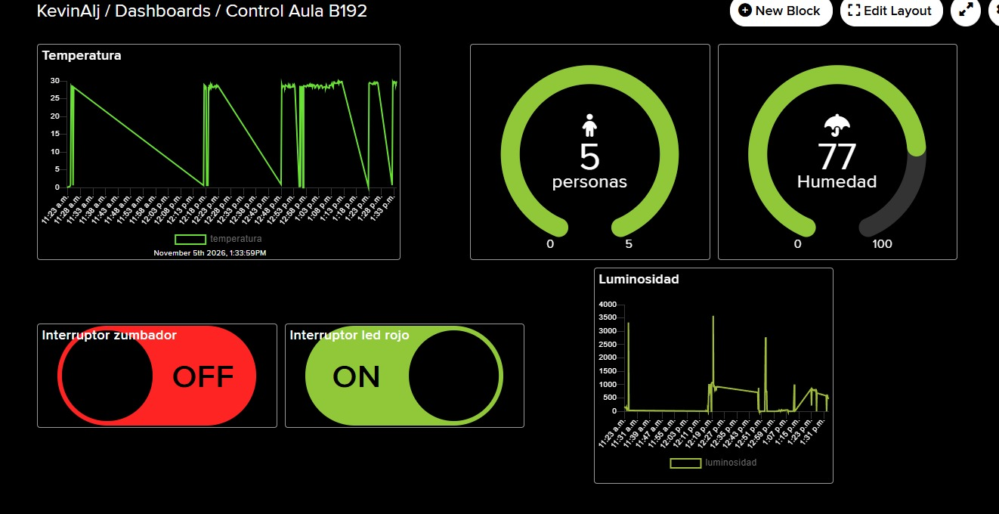
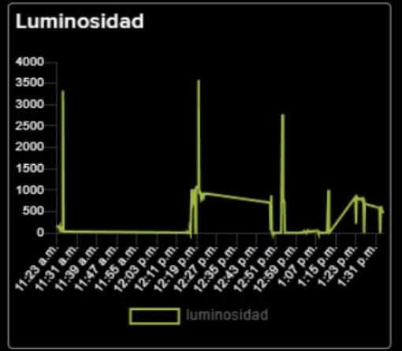
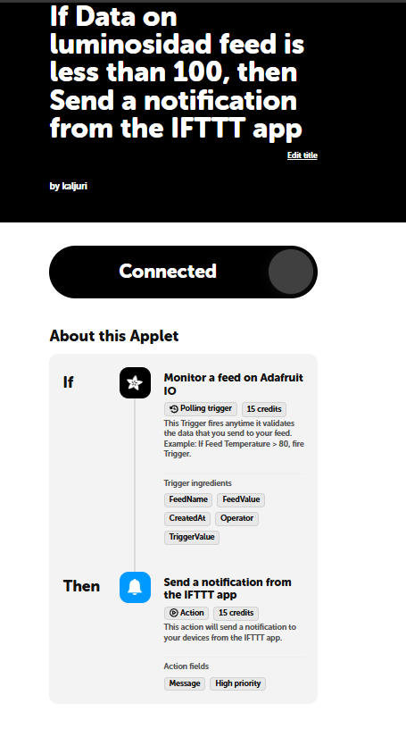
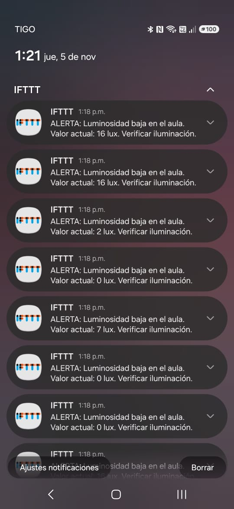
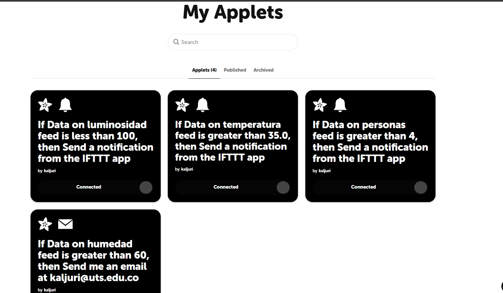
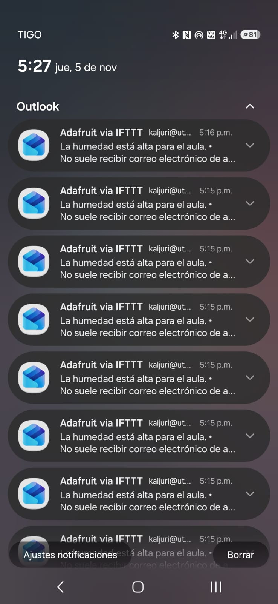
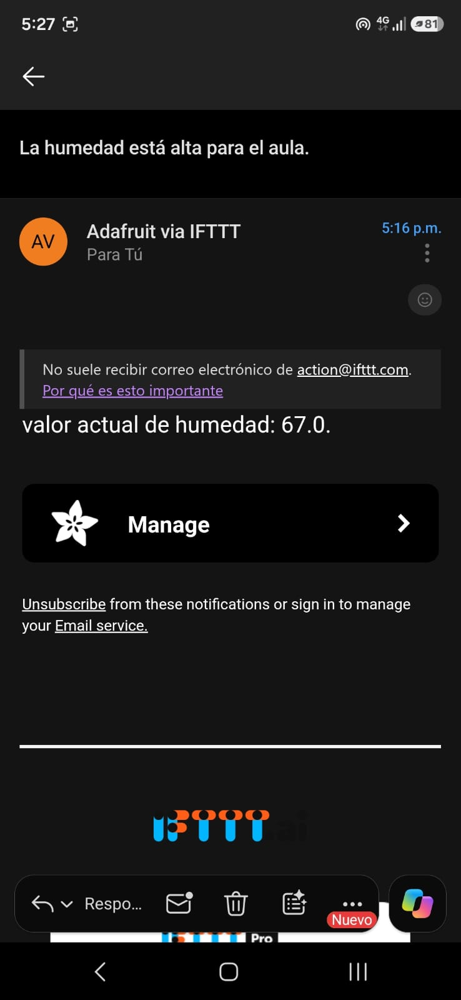

# Sistema IoT para el control de aula (Grupo B192) Internet de las cosas.

**Autores:** Kevin Aljuri y Diana Beltrán
**Actividad:** Proyecto IoT – Semana 13 (ESP32 + Adafruit IO + IFTTT)

---

## 1. Descripción del proyecto

Sistema IoT que monitorea un aula de clase con un **ESP32** y envía los datos a **Adafruit IO** por MQTT. Desde ahí, **IFTTT** envía alertas al celular del coordinador, que no puede estar todo el día frente al dashboard.

El sistema mide y controla:

| Variable | Sensor / Actuador | Feed en Adafruit IO |
|---|---|---|
| Luminosidad | LDR | `luminosidad` |
| Temperatura | DHT11 | `temperatura` |
| Humedad | DHT11 | `humedad` |
| Personas en el aula (entradas/salidas) | 2 sensores IR | `personas` |
| LED rojo (control remoto) | LED | `led-rojo` |
| Buzzer / zumbador (control remoto) | Buzzer | `buzzer` |
       TABLA 1. variables.

**Lógica local del ESP32:** si el aforo supera 5 personas se enciende el LED rojo y suena el buzzer, si no, permanece el LED verde. El LED rojo y el buzzer también se pueden activar a mano desde los interruptores del dashboard.

**Alertas con IFTTT (applets):**

| Condición | Acción |
|---|---|
| `luminosidad` menor que 100 | Notificación push en la app de IFTTT |
| `temperatura` mayor que 35.0 | Notificación push en la app de IFTTT |
| `personas` mayor que 4 | Notificación push en la app de IFTTT |
| `humedad`  mayor que 60 | Correo electrónico |

---
 TABLA 2. CONDICIONES DE IFTTT.
## 2. Diagrama de conexión

Pines usados en el ESP32 DevKit:

| Componente | Pin ESP32 | Nota |
|---|---|---|
| Sensor IR A (entrada) | GPIO 17 | Activo en LOW |
| Sensor IR B (salida) | GPIO 18 | Activo en LOW |
| DHT11 (temperatura y humedad) | GPIO 16 | Señal de datos |
| LDR (luminosidad) | GPIO 32 | Entrada analógica (ADC), con divisor de voltaje |
| LED verde | GPIO 19 | Con resistencia en serie |
| LED rojo | GPIO 21 | Con resistencia en serie |
| Buzzer | GPIO 22 | Salida digital |
    TABLA 3. Pins ESP32.
```

                       ┌──────────────────┐
  IR A  ───────────────┤ GPIO 17          │
  IR B  ───────────────┤ GPIO 18          │
  DHT11 (datos) ───────┤ GPIO 16          │
  LDR + resistencia ───┤ GPIO 32 (ADC)    │
                       │       ESP32      │
  LED verde (+R) ◄─────┤ GPIO 19          │
  LED rojo  (+R) ◄─────┤ GPIO 21          │
  Buzzer         ◄─────┤ GPIO 22          │
                       └────────┬─────────┘
                                │ WiFi
                                ▼
                         Adafruit IO (MQTT)
```
 DIAGRAMA 1. Diagrama de conexión del sensor al ESP32.

**Divisor de voltaje del LDR:** el LDR se conecta en serie con una resistencia fija entre 3.3 V y GND. El punto medio va al GPIO 32. Al cambiar la luz cambia el voltaje que lee el ADC (0 a 4095).

---

## 3. Flujo del sistema

```
Sensor → ESP32 → Adafruit IO → IFTTT → Notificación push
```

1. **Sensor:** el LDR (y los demás sensores) generan lecturas.
2. **ESP32:** lee los sensores y publica por MQTT (`io.adafruit.com`, puerto 1883) cada **15 segundos** los datos ambientales. Las personas se publican en cada entrada o salida. Si la conexión MQTT se cae, el código la restablece solo (`vigilarMQTT()`), sin usar `delay()` largos.
3. **Adafruit IO:** recibe los datos en los feeds y los muestra en el dashboard *Control Aula B192* (gráficas históricas, gauges e interruptores).
4. **IFTTT:** el applet usa el trigger *Monitor a feed on Adafruit IO* (tipo *polling*). Cada vez que valida un dato nuevo que cumple la condición, dispara la acción.
5. **Notificación push:** IFTTT envía la alerta a la app instalada en el celular.

**Observación sobre los tiempos:** el trigger de Adafruit en IFTTT consulta el feed cada cierto tiempo, no recibe el dato al instante. En las pruebas, las 9 notificaciones acumuladas llegaron juntas a la 1:18 p. m., aunque los datos ya estaban en el feed desde antes. El sistema funciona, pero el plan gratuito de IFTTT agrupa y retrasa las notificaciones para que se presenten cada hora.

---

## 4. Evidencias 


### 4.1 Dashboard de Adafruit IO

FIGURA 1. Dashboard adafruit.

Dashboard *Control Aula B192* con temperatura, personas, humedad, luminosidad y los interruptores del zumbador y del LED rojo.

### 4.2 Gráfico histórico (Line Chart)

FIGURA 2. Grafico histórico.

Line Chart del feed `luminosidad`, en el cual se logran ver los picos y valles a lo largo del tiempo al cambio de luz.

### 4.3 Applet de IFTTT configurado

FIGURA 3. Applet de IFTTT.

Applet *"If Data on luminosidad feed is less than 100, then Send a notification from the IFTTT app"* en estado **Connected**.

### 4.4 Notificación push recibida

FIGURA 4. Notificación push.
En la figura 4, se logra ver la captura del celular con la alerta recibida sobre que la luminosidad en el aula es muy reducida.

---

## 5. Evidencias adicionales: los demás sensores

Además del taller de luminosidad se implementó el sistema completo:

| Applet | Condición |
|---|---|
| Luminosidad | menor que 500 (primera prueba) / menor que 100 (taller) |
| Temperatura | mayor que 35.0 |
| Personas | mayor que 4 |



Los pasos para crearlos están en `informe_tecnico.md`.

---

## 6. Alerta de humedad por correo

Además de las notificaciones push, se configuró un applet que avisa **por correo electrónico** cuando la humedad llega a un nivel de peligro.

- **Trigger (This):** Adafruit → *Monitor a feed* → feed `humedad` → condición **[mayor que 60 %]**
- **Acción (That):** correo electrónico con el valor actual de humedad.

| Evidencia | Imagen |
|---|---|
| Correo recibido |  |
| Lectura del correo |  |

---

## 7. Código fuente

El código completo y comentado está en [`codigo/esp32_luminosidad.ino`](codigo/esp32_luminosidad.ino). Funciones principales:

| Función | Qué hace |
|---|---|
| `conectarWifiInicial()` | Conecta el ESP32 a la red WiFi |
| `vigilarMQTT()` | Reconecta a Adafruit IO sin bloquear el programa (equivale a `reconnect()`) |
| `leerIR()` | Máquina de estados que detecta entradas y salidas con los dos sensores IR |
| `leerYPublicarAmbiente()` | Lee LDR y DHT11 y publica cada 15 s |
| `callbackMQTT()` | Recibe órdenes del dashboard (LED rojo y buzzer) |
| `actualizarLeds()` / `actualizarBuzzer()` | Controlan las alertas locales por aforo |

> **Seguridad:** el archivo `config.h` contiene la contraseña del WiFi y la `AIO_KEY` de Adafruit IO. **No se sube al repositorio.** Se incluye un `config.example.h` con valores de ejemplo:
> ```cpp
> #define WIFI_SSID    "red"
> #define WIFI_PASS    "clave"
> #define AIO_USERNAME "user"
> #define AIO_KEY      "aio_key"
> ```

---

## 8. Conclusiones

- Con un ESP32, Adafruit IO e IFTTT se puede armar un flujo completo de monitoreo y alertas sin programar servidores ni envío de correos desde el microcontrolador.
- La automatización evita que una persona esté pendiente del dashboard: el sistema avisa cuando ocurre una anomalía (poca luz, temperatura alta, aforo excedido, humedad en peligro).
- Probamos que la cadena funciona de punta a punta, aunque el plan gratuito de IFTTT tiene retrasos y agrupa las notificaciones (trigger de tipo *polling*).
- Publicar datos cada 10 a 15 segundos es importante, porque IFTTT evalúa cada dato nuevo. Si se publica muy seguido y la condición se cumple siempre, se generan muchas notificaciones repetidas.
- El correo electrónico es una alternativa más confiable para alertas críticas.
- Mejoras posibles: aumentar el rendimiento con otro servicio de notificación (Telegram, webhooks) y calibrar el LDR para obtener valores reales en lux.
