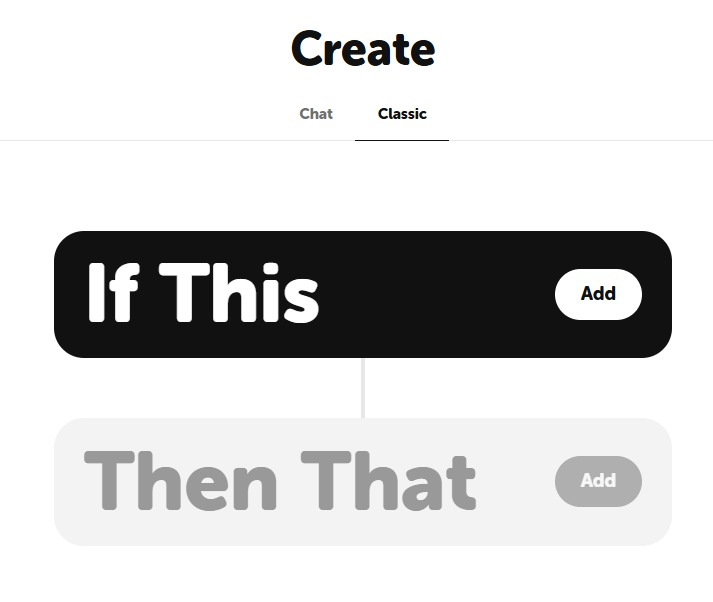
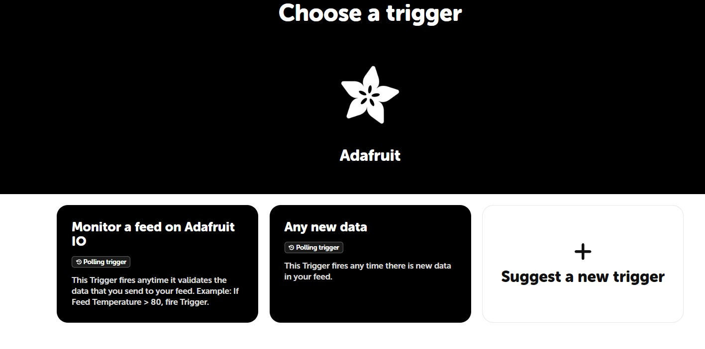
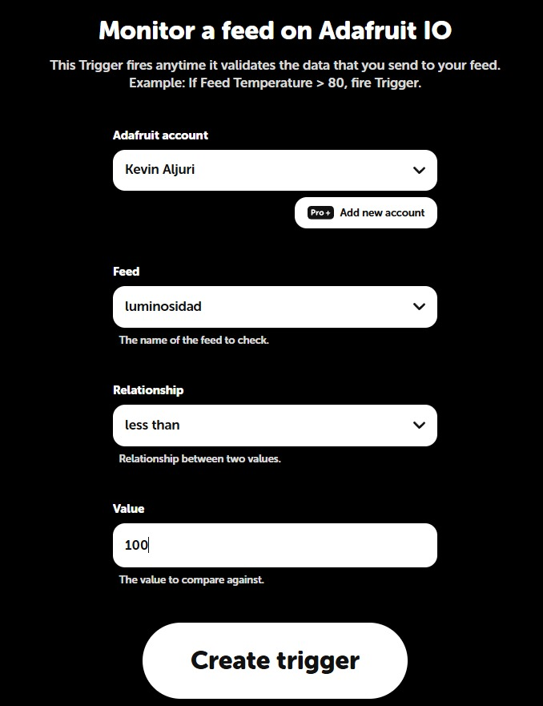
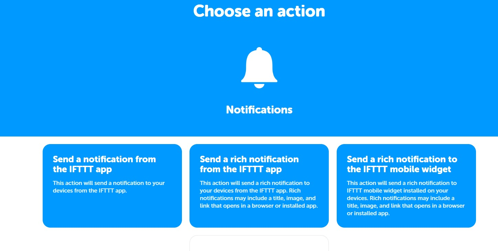
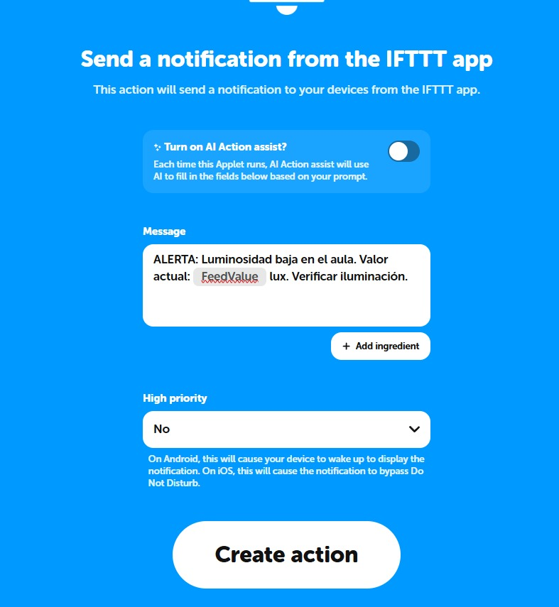
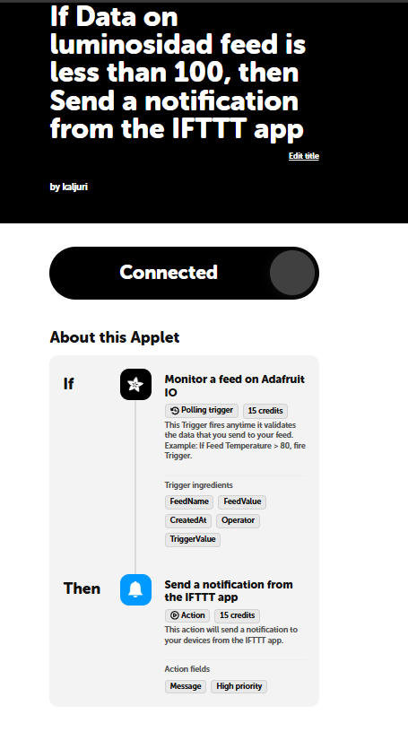
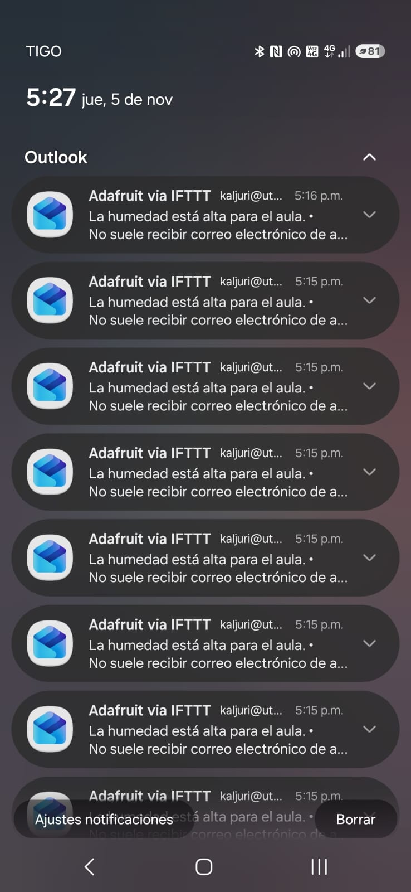
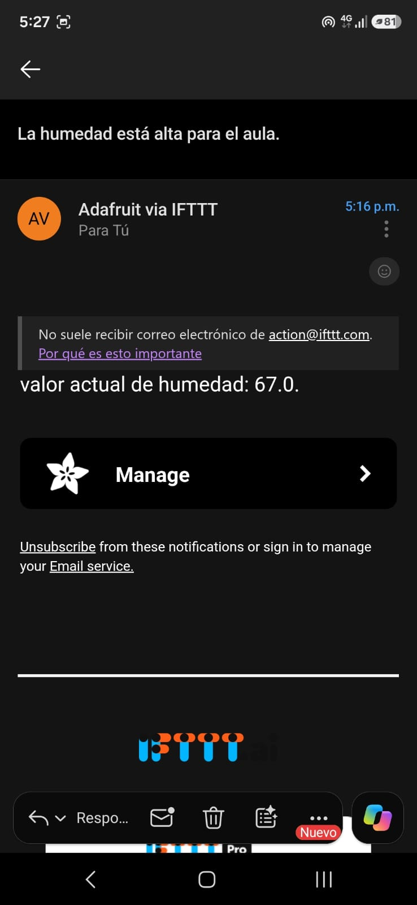

# Informe técnico: Sistema IoT para el control de aula (Grupo B192)

**Autores:** Kevin Aljuri y Diana Beltrán
**Actividad:** Proyecto IoT – Semana 13 (ESP32 + Adafruit IO + IFTTT)

---

## 1. Objetivo

Construir un flujo completo de IoT que capture datos del aula con un ESP32, los publique en Adafruit IO y notifique al coordinador académico cuando ocurra una anomalía, usando IFTTT como puente de automatización. La actividad pide la alerta por luminosidad baja (menor que 100). El proyecto se extendió a temperatura, humedad y control de aforo.

## 2. Materiales

- ESP32 DevKit, sensor LDR, DHT11, dos sensores IR, LED verde y rojo, buzzer, resistencias, protoboard y cables.
- Arduino IDE con las librerías `WiFi.h`, `PubSubClient.h` y `DHT.h`.
- Cuentas de Adafruit IO, IFTTT y GitHub, y la app de IFTTT en el celular.
- Red WiFi con acceso a Internet.

---

## 3. Desarrollo

### 3.1 Conexión del sensor y lectura de datos

El LDR se conectó a un divisor de voltaje y su punto medio va al GPIO 32 (entrada ADC). Las lecturas se imprimen por el monitor serial y varían al cubrir o descubrir el sensor. El ESP32 entrega valores crudos del ADC (0 a 4095), no lux: un valor cercano a 0 equivale a oscuridad y uno alto a luz intensa. Los demás pines están en la Tabla 3 del `README.md`.

### 3.2 Configuración de Adafruit IO

Se crearon los feeds `luminosidad`, `temperatura`, `humedad`, `personas`, `led-rojo` y `buzzer`. El ESP32 se conecta al servidor `io.adafruit.com` por el puerto 1883 con las credenciales `AIO_USERNAME` y `AIO_KEY`, guardadas en `config.h`, que no se sube al repositorio.

### 3.3 Código

El código [`codigo/esp32_luminosidad.ino`](codigo/esp32_luminosidad.ino) cumple lo siguiente:

- Publica luminosidad, temperatura y humedad cada **15 segundos**.
- Publica el número de personas en cada entrada o salida detectada por los dos sensores IR.
- Mantiene la conexión MQTT con `vigilarMQTT()`, que reintenta cada 5 segundos sin bloquear el programa. Hace la función de `reconnect()`.
- Evita `delay()` largos: solo usa pausas de 500 ms entre publicaciones para no saturar el límite de datos por minuto de Adafruit IO.
- Recibe órdenes desde el dashboard (LED rojo y buzzer) con `callbackMQTT()`.

### 3.4 Validación en la nube

Los datos llegan en tiempo real a los feeds y se muestran en el dashboard *Control Aula B192* (Figura 1 del README), con gráficas de temperatura y luminosidad, indicadores de personas y humedad, y los interruptores del zumbador y del LED rojo.

### 3.5 Visualización histórica

Se creó un widget *Line Chart* asociado al feed `luminosidad` y el sistema funcionó más de 5 minutos continuos (Figura 2 del README).

---

## 4. Análisis de tendencia (Actividad 3.2)

**¿La luminosidad se mantuvo estable o presentó picos?**
No se mantuvo estable. La gráfica muestra **picos marcados** sobre una línea base cercana a 0. Hubo picos de entre 3.300 a 3.500, se le acercó luz, o algunos datos de 900 a 1200. La variación se deben a las pruebas que se realizaron para que el Adafruit y el IFTTT reaccionaran al cambio.

**¿En qué momento del día se detectó el valor más bajo?**
El valor más bajo, cercano a 0, se registró en la **mañana y a mediodía**: se mantuvo de forma sostenida desde aproximadamente las **11:30 a. m. hasta las 12:15 p. m.**, con el sensor cubierto. Ese rango está por debajo del umbral de 100 y es el que debe disparar la alerta.

---

## 5. Automatización con IFTTT

Cada applet sigue el modelo *Trigger–Action* (This → That).

### 5.1 Applet de luminosidad (actividad principal)

1. **Crear el applet.** En ifttt.com, se entra a *Create*. Se pulsa **This** para configurar el disparador .
2. **Elegir el servicio.** Se busca **Adafruit** y se selecciona el trigger *Monitor a feed on Adafruit IO* .
3. **Definir la condición.** Se elige el feed `luminosidad`, el operador **Less than** y el valor **100** .
4. **Configurar la acción.** Se pulsa **That** (`extra/that.jpeg`), se busca el servicio **Notifications** y se elige *Send a notification from the IFTTT app*  .
5. **Escribir el mensaje.** Se personaliza el texto con el valor recibido del feed .
6. **Guardar y activar.** El applet queda en estado **Connected** .

### 5.2 Applets de temperatura y personas

Se crean igual, cambiando el feed y la condición:

| Applet | Feed | Condición | Acción |
|---|---|---|---|
| Temperatura | `temperatura` | Greater than 35.0 | Notificación push |
| Personas | `personas` | Greater than 4 | Notificación push |

El umbral de personas es 4 porque el aforo máximo definido en el código es 5. Así la alerta avisa antes de que se exceda. Los tres applets se ven en `extra/Applets.jpeg`.

### 5.3 Applet de humedad por correo

El trigger usa el feed `humedad` con la condición **Greater than 60**. La acción es un **correo electrónico** con el valor actual. Se escogió el correo porque es más fiable que la notificación push de la app para alertas importantes
).

### 5.4 Prueba de la alerta

Se cubrió el LDR para simular luminosidad menor que 100 y se esperó la notificación en el celular (Figura 4 del README). Las notificaciones **llegaron agrupadas a la 1:18 p. m.**, no en el momento del evento. La causa es que el trigger de Adafruit en IFTTT es de tipo *polling*: IFTTT consulta el feed cada cierto tiempo y procesa en bloque los datos acumulados. El ESP32 y Adafruit IO funcionaron correctamente; el retraso lo introduce el plan gratuito de IFTTT.

---

## 6. Preguntas de reflexión

**1. ¿Qué ventaja ofrece IFTTT frente a programar el envío de correos directamente desde el ESP32?**
IFTTT evita programar y mantener en el ESP32 un cliente SMTP con credenciales de correo, certificados y manejo de errores, que consume memoria y es difícil de depurar. Con IFTTT la lógica de la alerta se configura en la nube sin modificar el firmware, se puede cambiar el umbral o la acción sin volver a cargar el código, y se pueden encadenar muchos servicios (notificaciones, correo, hojas de cálculo, mensajería).

**2. ¿Por qué es importante que el ESP32 publique datos con una frecuencia adecuada (10–15 s)?**
IFTTT evalúa la condición cada vez que llega un dato nuevo al feed. Si se publica muy poco, el applet puede no ver nunca el valor crítico, ya que una lectura baja puede pasar entre dos publicaciones. Si se publica demasiado seguido, se supera el límite de datos por minuto de Adafruit IO y se genera una cantidad excesiva de notificaciones repetidas (una por cada dato que cumpla la condición). Con 15 s se equilibran ambas cosas y se deja margen para las publicaciones de los otros sensores.

**3. ¿Qué otras acciones (That) podrían configurarse en IFTTT además de la notificación push?**
Envío de correo electrónico, mensajes a Telegram o Slack, registro de eventos en una hoja de Google Sheets para llevar un historial, activación de dispositivos inteligentes (luces o enchufes), llamadas webhook a otro sistema y SMS. En este proyecto servirían para avisar a varias personas a la vez, llevar un registro de incidentes de aforo y temperatura, y activar un ventilador o las luces de forma automática.

**4. ¿Qué limitaciones encontró al usar la versión gratuita de Adafruit IO?**
El plan gratuito tiene retención limitada del histórico (30 días), un límite de datos por minuto, y un número limitado de feeds y dashboards. Por eso el código separa las publicaciones con pausas de 500 ms. 

---

## 8. Conclusiones

Se validó con éxito el flujo completo desde el sensor y el ESP32 hasta Adafruit IO, IFTTT y la notificación push mediante pruebas de luminosidad, temperatura, personas y humedad. Esta automatización optimiza la gestión al liberar al coordinador de la vigilancia constante del dashboard, ya que el sistema avisa automáticamente ante cualquier anomalía. No obstante, se identificó que la principal limitación no radica en el hardware, sino en las restricciones del plan gratuito de IFTTT, cuyo método de polling agrupa y retrasa las alertas. Por lo tanto, para notificaciones críticas se recomienda complementar el push con avisos por correo electrónico, y como mejoras futuras, implementar servicios en tiempo real como Telegram o webhooks, además de calibrar el LDR para registrar valores reales en lux.
