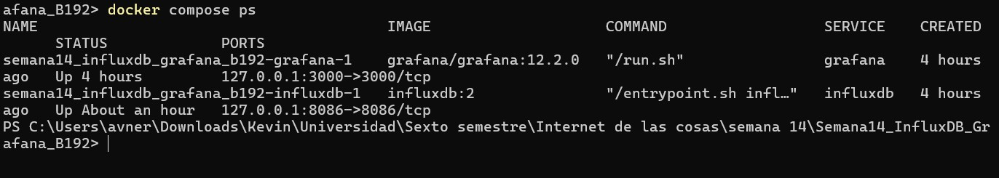
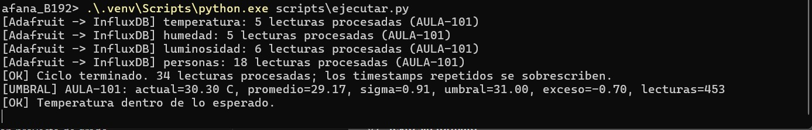
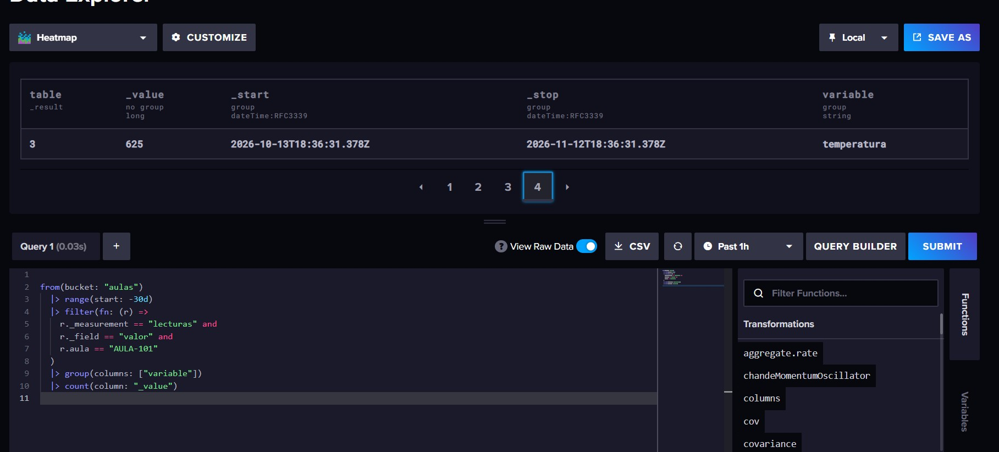
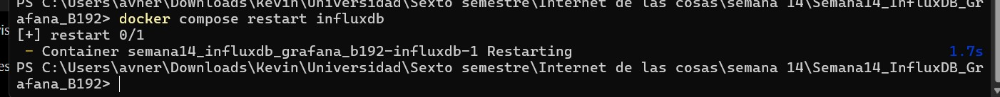
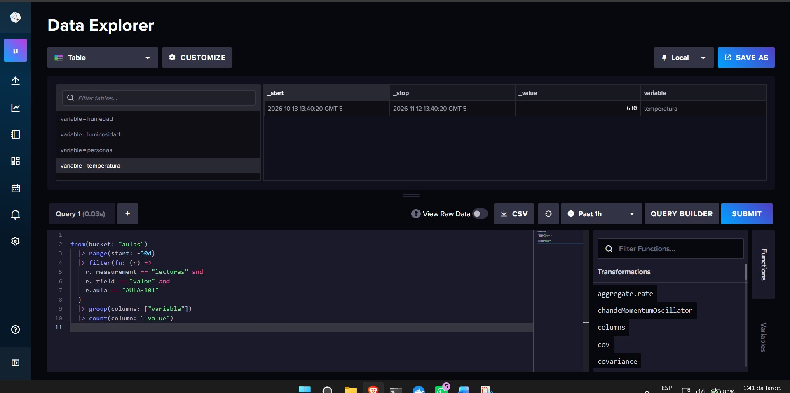
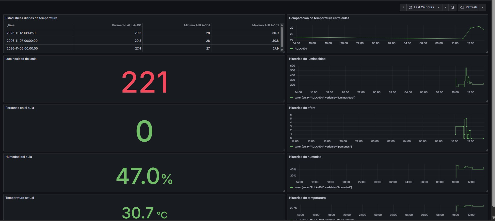
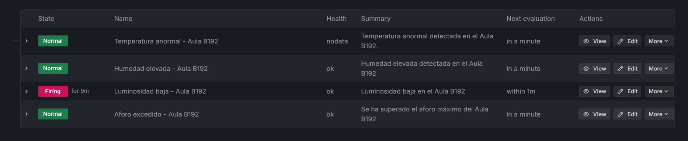
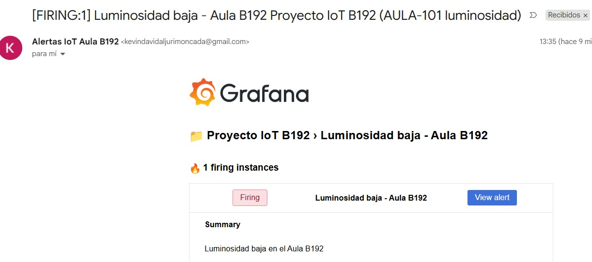

# Sistema IoT para el control de aulas — Semana 14

**Unidades Tecnológicas de Santander (UTS)**

**Asignatura:** Internet de las Cosas (IoT)  
**Grupo:** B192  
**Integrantes:** Kevin David Aljuri Moncada y Diana Marcela Beltrán Suárez  
**Docente:** Eliecer Montero Ojeda  
**Año:** 2026

## 1. Introducción

En la semana 13 se conectó el ESP32 con Adafruit IO e IFTTT para mostrar las mediciones del aula y recibir avisos cuando se superaban ciertos valores.

En esta semana 14 se continuó con el mismo montaje, pero se añadió una base de datos local para conservar los datos históricos y analizarlos con mayor detalle.

Para esto se utilizaron Python, InfluxDB y Grafana, sin cambiar el funcionamiento principal de los sensores ni los controles del LED rojo y el buzzer.

## 2. Objetivo

Implementar un sistema de almacenamiento avanzado que permita guardar y consultar las mediciones del aula y comprobar que los datos permanecen almacenados después de reiniciar el servidor local.

## 3. Componentes y herramientas

El montaje utiliza:

- ESP32 DevKit con WiFi.
- Sensor DHT11: temperatura y humedad.
- Sensor LDR: luminosidad.
- Dos sensores infrarrojos: entradas y salidas.
- LED verde, LED rojo y buzzer.
- Protoboard y cables de conexión.

Las herramientas utilizadas son:

- **Adafruit IO:** recibe las mediciones mediante MQTT.
- **Python:** consulta los datos de Adafruit IO.
- **InfluxDB:** almacena las mediciones históricas.
- **Grafana:** permite visualizar y analizar los datos.
- **Docker Desktop:** ejecuta los servicios locales.
- **Gmail:** recibe las alertas de Grafana.

## 4. Funcionamiento del sistema

El flujo general es:

ESP32 → Adafruit IO → Python → InfluxDB → Grafana → Gmail

El ESP32 publica temperatura, humedad y luminosidad aproximadamente cada 15 segundos. El número de personas se publica al detectar entradas y salidas y al reconectarse a MQTT.

Python consulta los cuatro feeds de Adafruit IO y almacena las mediciones en el bucket `aulas` de InfluxDB.

Grafana consulta esos registros para mostrar indicadores, gráficas históricas, estadísticas y alertas.

Los controles del LED rojo y del buzzer continúan funcionando mediante Adafruit IO.

## 5. Instalación y ejecución

Se utilizó un computador con Windows, Python y Docker Desktop.

Los contenedores se configuran mediante `compose.yaml`.

Para iniciar InfluxDB y Grafana:

```powershell
docker compose up -d
docker compose ps
```

Direcciones locales:

- InfluxDB: http://localhost:8086
- Grafana: http://localhost:3000

Para instalar las dependencias de Python:

```powershell
py -m venv .venv
.\.venv\Scripts\python.exe -m pip install -r requirements.txt
```

Las credenciales se configuran en un archivo privado `.env`, utilizando `.env.example` como referencia.

Para comenzar la sincronización:

```powershell
.\.venv\Scripts\python.exe scripts\ejecutar.py
```

El programa consulta los feeds, almacena las lecturas en InfluxDB y calcula el umbral dinámico de temperatura.

## 6. Evidencias de funcionamiento

### 6.1. Servicios de Docker

Se configuraron los contenedores de InfluxDB y Grafana y se comprobó su funcionamiento con `docker compose ps`.



### 6.2. Almacenamiento mediante Python

El script procesa las mediciones de temperatura, humedad, luminosidad y personas, conservando sus fechas y horas en InfluxDB.



### 6.3. Datos almacenados en InfluxDB

Desde Data Explorer se consultaron los registros disponibles en el bucket `aulas`, identificados mediante la etiqueta `AULA-101`.



### 6.4. Verificación de persistencia

Se reinició el servicio mediante el comando:

```powershell
docker compose restart influxdb
```



Posteriormente, se consultó nuevamente la base de datos y se comprobó que los registros continuaban disponibles.



### 6.5. Dashboard de Grafana

Se creó el dashboard **Control Inteligente de Aula B192 - Semana 14**, que incluye:

- Indicadores de temperatura, humedad, luminosidad y personas.
- Gráficas históricas de las cuatro variables.
- Tabla de promedio, mínimo y máximo diario.
- Panel de comparación de temperatura entre aulas.



Por el momento se tienen mediciones identificadas como `AULA-101`. La comparación con una segunda aula queda como una limitación de la práctica.

### 6.6. Alertas del sistema

Se configuró una alerta dinámica de temperatura utilizando el promedio y dos desviaciones estándar del histórico disponible.

**Umbral dinámico = Promedio + 2 × desviación estándar**

Grafana evalúa la diferencia entre la temperatura actual y este umbral.

También se crearon reglas para:

- Humedad elevada: mayor que 60 %.
- Luminosidad baja: menor que 100 ADC.
- Aforo excedido: más de 5 personas.



Las alertas se vincularon con un contacto de correo electrónico. Durante las pruebas se comprobó la recepción de una notificación por luminosidad baja.



## 7. Archivos del proyecto

La carpeta `scripts/` contiene:

- `comun.py`: configuración compartida y conexión con InfluxDB.
- `ingesta.py`: lectura de los feeds de Adafruit IO y almacenamiento.
- `alertas.py`: cálculo del umbral dinámico de temperatura.
- `ejecutar.py`: ejecución periódica de la sincronización y las alertas.

La carpeta `dashboards/` contiene el dashboard exportado como JSON y las consultas Flux utilizadas para construir los paneles.

La carpeta `docs/` contiene las capturas de las pruebas realizadas.

## 8. Dificultades y limitaciones

Durante la configuración se presentaron dificultades con las credenciales iniciales de InfluxDB y con la creación de las expresiones de alerta en Grafana.

También se observaron algunas lecturas atípicas de temperatura, que deben revisarse antes de sacar conclusiones sobre las condiciones ambientales.

El sistema utiliza actualmente un solo montaje, por lo que no se realizó una comparación real entre dos aulas.

Para continuar almacenando nuevas mediciones, es necesario mantener el computador, los servicios de Docker y el script de Python funcionando.

## 9. Cómo detener y volver a iniciar el sistema

Para detener la sincronización de Python se utiliza `Ctrl + C` en su terminal.

Después se ejecuta:

```powershell
docker compose stop
```

Para iniciar nuevamente el sistema otro día:

1. Abrir Docker Desktop.
2. Conectar el ESP32.
3. Abrir PowerShell en la carpeta del proyecto.
4. Ejecutar `docker compose up -d`.
5. Ejecutar `.\.venv\Scripts\python.exe scripts\ejecutar.py`.
6. Abrir Grafana y consultar el dashboard.

Los registros de InfluxDB y la configuración del dashboard se conservan al detener los servicios normalmente.

No se debe ejecutar `docker compose down -v`, porque elimina los volúmenes de almacenamiento.

## 10. Conclusiones

Se logró integrar el sistema IoT desarrollado anteriormente con InfluxDB para almacenar las mediciones de temperatura, humedad, luminosidad y personas.

La consulta de los registros después de reiniciar el servicio permitió comprobar la persistencia del almacenamiento local.

Grafana facilitó la visualización de los datos mediante indicadores, gráficas y estadísticas, así como la configuración de alertas con notificaciones por Gmail.

Con esta actividad se complementó el trabajo de la semana 13, pasando de visualizar los valores del momento a conservarlos para analizarlos posteriormente.

## 11. Referencias

- Adafruit IO: https://io.adafruit.com
- InfluxDB: https://docs.influxdata.com/
- Grafana: https://grafana.com/docs/
- Proyecto anterior: https://github.com/KevinAljuri/Iot-Kevin-Diana/tree/main/proyecto-iot-semana13
