# Sistema IoT para el control de entradas y salidas en aulas de clase

## Semana 15 — Visualización histórica y alertas dinámicas

**Unidades Tecnológicas de Santander (UTS)**  
**Asignatura:** Internet de las Cosas (IoT)  
**Grupo:** B192  
**Integrantes:** Kevin David Aljuri Moncada y Diana Marcela Beltrán Suárez  
**Docente:** Eliecer Montero Ojeda  
**Ciudad y año:** Bucaramanga, 2026

---

## 1. Introducción

En la semana 13 desarrollamos un sistema IoT para controlar las entradas y salidas de personas en un aula, utilizando un ESP32, sensores y Adafruit IO. Con esta plataforma visualizábamos las mediciones y controlábamos el LED rojo y el buzzer.

Durante la semana 14 incorporamos Python e InfluxDB para almacenar las mediciones de temperatura, humedad, luminosidad y aforo con su fecha y hora. También comprobamos que la información permanecía disponible después de reiniciar el servicio.

En la **semana 15** continuamos con el mismo montaje, pero nos concentramos en mejorar la visualización histórica con Grafana. Organizamos el dashboard, agregamos un selector de aula, comparamos dos sesiones, incorporamos un indicador de estado dinámico (*Gauge*) y comprobamos las alertas mediante una simulación controlada de temperatura alta. **No reemplazamos Adafruit IO ni InfluxDB: todas las herramientas forman parte del mismo sistema.**

## 2. Objetivos

**Objetivo general:** Consolidar la visualización histórica y las alertas dinámicas del sistema IoT mediante Grafana y las mediciones almacenadas en InfluxDB.

**Objetivos específicos:**

- Mantener la comunicación **ESP32 → Adafruit IO → Python → InfluxDB → Grafana**.
- Visualizar temperatura, humedad, luminosidad y personas mediante indicadores y gráficas.
- Mostrar las tendencias de temperatura y luminosidad de las últimas 24 horas.
- Comparar las series identificadas como `AULA-101` y `AULA-102`.
- Consultar promedios, mínimos y máximos diarios de temperatura.
- Utilizar una variable interactiva para seleccionar el aula y un Gauge según el umbral estadístico.
- Simular una anomalía y comprobar la activación de una alerta por Gmail.
- Documentar las pruebas y conservar el código y el dashboard exportado.

## 3. Materiales y herramientas

Se conservó el montaje de las semanas anteriores: **ESP32 DevKit, sensor DHT11, LDR, dos sensores infrarrojos, LED verde, LED rojo, buzzer, protoboard y cables**.

| Herramienta | Función dentro del proyecto |
|---|---|
| **ESP32** | Lee los sensores y controla los actuadores. |
| **Adafruit IO** | Recibe las mediciones mediante MQTT y mantiene los controles del LED y del buzzer. |
| **Python** | Consulta los feeds, envía las lecturas a InfluxDB y calcula el umbral dinámico. |
| **InfluxDB 2.x** | Conserva el histórico de mediciones con sus marcas de tiempo y etiquetas. |
| **Docker Desktop** | Ejecuta los servicios locales de InfluxDB y Grafana. |
| **Grafana** | Presenta indicadores, tendencias, estadísticas, comparaciones y reglas de alerta. |
| **Gmail** | Recibe los avisos enviados por Grafana. |

## 4. Funcionamiento general del sistema

El ESP32 publica las lecturas en Adafruit IO. Después, Python consulta los feeds `temperatura`, `humedad`, `luminosidad` y `personas`, y guarda los datos en el bucket **`aulas`** de InfluxDB. Cada registro se identifica por el tipo de variable, la etiqueta del aula, el valor y la fecha/hora de la medición.

**Flujo:** `ESP32 → Adafruit IO (MQTT) → Python → InfluxDB → Grafana → Gmail`

Los actuadores se siguen controlando desde Adafruit IO, mientras que Grafana utiliza los registros históricos y los cálculos guardados en InfluxDB para presentar el dashboard y evaluar alertas.

### Figura 1. Dashboard inicial de Adafruit IO

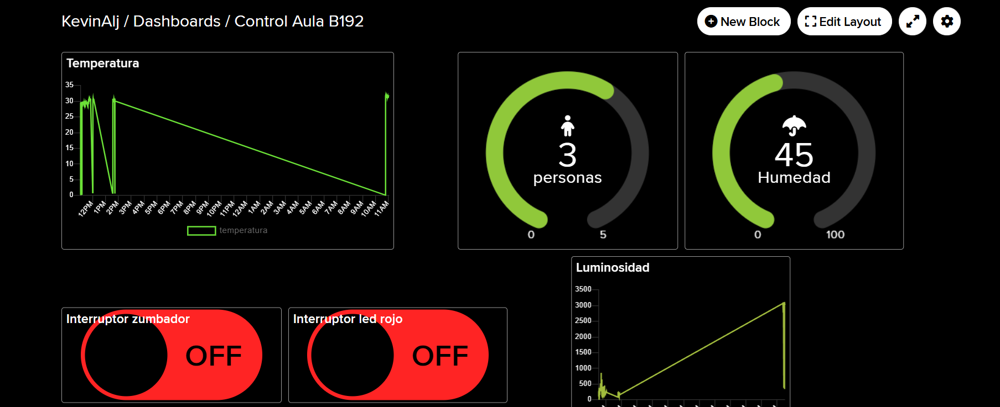

En la **figura 1** se observa el monitoreo inicial del aula y los controles del LED rojo y del buzzer. Esta plataforma se conservó al incorporar las herramientas de almacenamiento y visualización.

## 5. Procedimiento y evidencias

### 5.1. Continuidad del almacenamiento local

Se utilizaron los servicios de InfluxDB y Grafana que ya habíamos configurado en la semana 14 mediante Docker. Desde la carpeta operativa que contiene `compose.yaml`, iniciamos y comprobamos los contenedores:

```powershell
docker compose up -d
docker compose ps
```

### Figura 2. Servicios de InfluxDB y Grafana en Docker

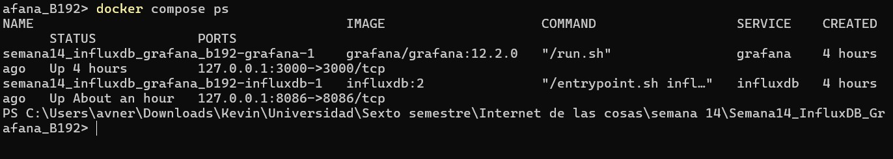

En la **figura 2** se muestra que ambos servicios se ejecutan en el computador: InfluxDB en `http://localhost:8086` y Grafana en `http://localhost:3000`.

Para mantener la sincronización de los sensores utilizamos el programa Python que se venía ejecutando desde la semana 14:

```powershell
.\.venv\Scripts\python.exe scripts\ejecutar.py
```

### Figura 3. Python consultando las cuatro variables

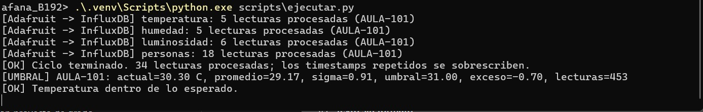

En la **figura 3** se observa que el programa consulta las cuatro variables de Adafruit IO y procesa sus lecturas para almacenarlas en InfluxDB. También muestra el cálculo periódico del umbral dinámico de temperatura.

### Figura 4. Histórico guardado en InfluxDB

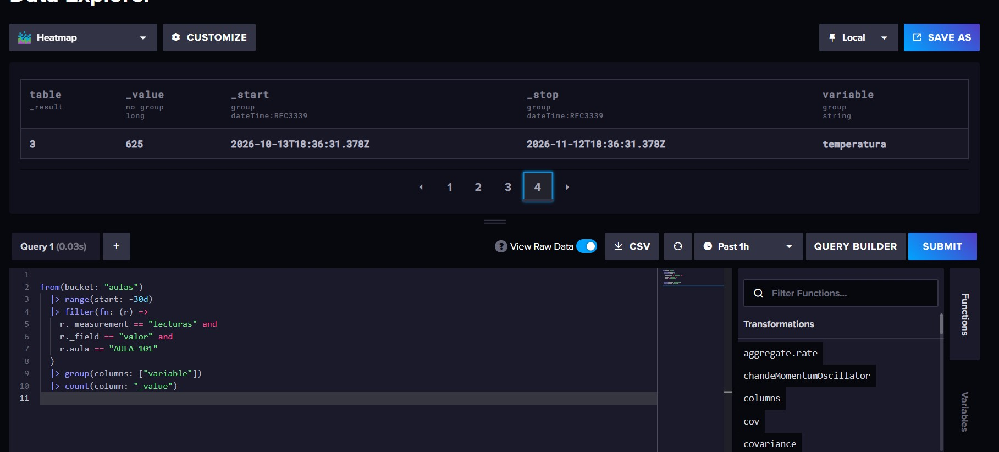

En la **figura 4** se evidencia que las mediciones pueden consultarse en InfluxDB. Los valores se almacenan con información del sensor y su fecha, en lugar de quedar únicamente en el histórico de Adafruit IO.

### Figura 5. Persistencia de los datos

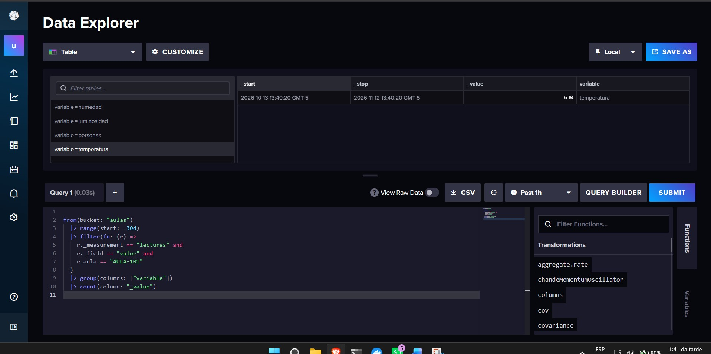

En la **figura 5** se conserva la prueba realizada en la semana 14: después de reiniciar el servicio de InfluxDB, los registros anteriores seguían disponibles. Este almacenamiento es la base de las gráficas utilizadas en la semana 15.

### 5.2. Dashboard de Grafana

Se reorganizó el dashboard **Control Inteligente de Aula B192** para facilitar la lectura de los datos. En la primera fila se colocaron los valores actuales de temperatura, humedad, luminosidad y personas, junto con el Gauge dinámico. Debajo quedaron las tendencias, el panel de comparación, la tabla diaria y los históricos complementarios de humedad y aforo.

El dashboard contiene **más de cuatro paneles** y cubre los cuatro tipos de visualización solicitados:

| Requisito de la semana 15 | Implementación |
|---|---|
| Tendencias de temperatura y luminosidad | Gráficas históricas consultadas para las últimas **24 horas**. |
| Comparación de aulas | Dos series etiquetadas `AULA-101` y `AULA-102`. |
| Agregaciones diarias | Tabla de **promedio, mínimo y máximo** de temperatura, con consulta para la última semana. |
| Gauge de estado | Verde, amarillo y rojo según la diferencia frente al umbral dinámico. |

La tabla muestra los días para los que existen registros; no se inventan mediciones para los días sin datos.

### Figura 6. Dashboard general y selector interactivo

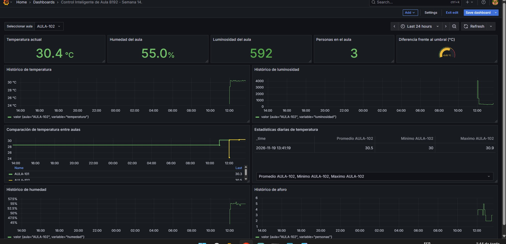

En la **figura 6** se observa la distribución final de los paneles. El selector **`Seleccionar aula`** permite consultar los indicadores de una sesión sin modificar manualmente todas las consultas.

### 5.3. Variable de aula y comparación de mediciones

Se creó una variable de Grafana llamada `aula`, que obtiene los identificadores registrados en InfluxDB. Al cambiar la selección, los paneles individuales pueden mostrar las lecturas de `AULA-101` o de `AULA-102`.

Para obtener la segunda serie se utilizó **el mismo prototipo en una sesión diferente**. En el panel comparativo aparecen ambas etiquetas, aunque sus mediciones no se tomaron simultáneamente. **Las dos etiquetas no demuestran, por sí solas, que se midieron dos salones físicos diferentes**; por ello esta evidencia se presenta como una comparación entre sesiones identificadas.

### Figura 7. Comparación de AULA-101 y AULA-102

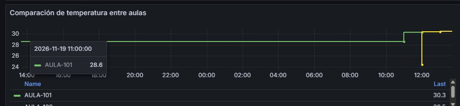

En la **figura 7** se observan las dos series registradas en InfluxDB. Como corresponden a momentos diferentes, algunas partes de las líneas aparecen en tramos distintos. Esta limitación se considera al interpretar los resultados.

### 5.4. Tendencias, estadísticas y Gauge dinámico

Las gráficas de temperatura y luminosidad permiten revisar los cambios de las últimas 24 horas, mientras que la tabla resume los valores **promedio, máximo y mínimo por día** en la semana consultada. Los históricos de humedad y aforo se conservaron como información adicional del aula.

El Gauge se configuró con el valor llamado **`exceso`**, que representa la diferencia entre la temperatura actual y el umbral estadístico:

**Exceso = temperatura actual − umbral dinámico**

| Color | Condición del exceso | Interpretación |
|---|---|---|
| 🟢 Verde | Menor que −2 °C | Temperatura por debajo del límite. |
| 🟡 Amarillo | Desde −2 °C hasta menos de 0 °C | Temperatura cercana al límite. |
| 🔴 Rojo | 0 °C o más | Límite alcanzado o superado. |

Por ejemplo, un valor de **−0,26 °C** significa que faltan 0,26 °C para llegar al umbral. **No significa que el aula tenga una temperatura negativa.** La regla real de alerta se activa cuando el exceso es *mayor que cero*.

### Figura 8. Gauge frente al umbral dinámico

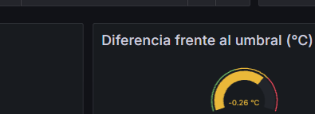

En la **figura 8** se observa cómo el Gauge representa la cercanía de la temperatura al límite estadístico mediante colores. Un valor negativo todavía puede ser normal o estar cerca de activarse la alerta.

### 5.5. Alertas dinámicas

En el funcionamiento habitual, el script **`alertas.py`**, desarrollado en la semana 14, consulta el histórico de temperatura disponible en InfluxDB y calcula:

**Umbral dinámico = promedio histórico + (2 × desviación estándar)**

A partir de ese valor obtiene el `exceso`, que queda registrado en InfluxDB. Grafana evalúa si el exceso supera cero y, cuando corresponde, notifica a través de Gmail.

También se mantuvieron las reglas de humedad elevada, luminosidad baja y aforo excedido. **Estas tres utilizan límites configurados**, mientras que la regla de temperatura utiliza el cálculo estadístico dinámico.

### Figura 9. Reglas configuradas en Grafana

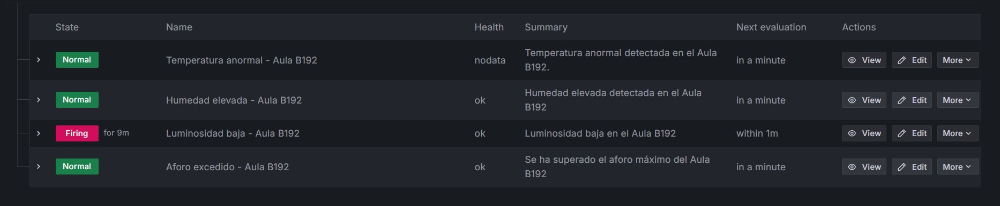

En la **figura 9** se muestran las cuatro reglas del sistema. Para comprobar específicamente las alertas de la semana 15 se creó otra regla independiente, identificada como prueba.

### 5.6. Simulación controlada de una temperatura anormal

Para comprobar el aviso sin modificar las lecturas de operación se creó el bucket independiente **`aulas_prueba_s15`**, con la etiqueta **`SIM-S15`**. El archivo [`scripts/simulacion_s15.py`](scripts/simulacion_s15.py) generó **25 temperaturas históricas simuladas** y una lectura anormal de **40 °C**.

El programa calculó primero las estadísticas de los 25 valores simulados en Python y luego guardó las lecturas y el exceso positivo en InfluxDB:

| Resultado de la prueba | Valor |
|---|---:|
| Temperatura media simulada | 27,60 °C |
| Desviación estándar | 0,42 °C |
| Umbral dinámico | 28,45 °C |
| Lectura anormal introducida | 40,00 °C |
| Exceso respecto al umbral | **+11,55 °C** |

**Aclaración técnica:** en esta simulación aislada el promedio y la desviación se calcularon directamente con los valores generados por Python **antes de almacenarlos**. En cambio, el script normal `alertas.py` trabaja con el histórico ya almacenado en InfluxDB. La simulación demuestra la escritura de datos y la activación de la regla, pero no debe presentarse como si hubiera vuelto a consultar esos 25 valores desde la base de datos.

### Figura 10. Cálculo estadístico de la simulación en Python

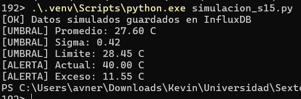

En la **figura 10** se observa la ejecución de la simulación: el valor de 40 °C supera el umbral calculado de 28,45 °C por 11,55 °C.

### Figura 11. Temperatura simulada almacenada en InfluxDB

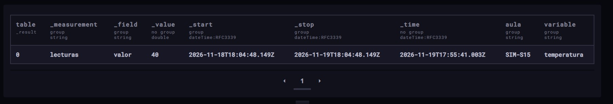

En la **figura 11** se muestra la lectura de 40 °C almacenada en un bucket diferente al usado por las aulas. Esto evita mezclar los datos de la prueba con las mediciones habituales.

### Figura 12. Regla de prueba en estado Firing

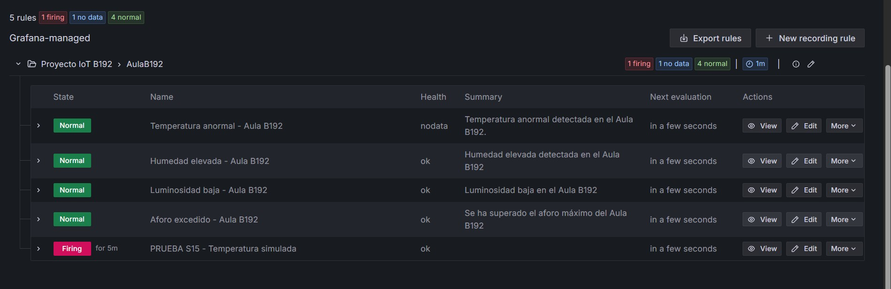

En la **figura 12** se evidencia que la regla **`PRUEBA S15 - Temperatura simulada`** alcanzó el estado *Firing* al detectar el exceso positivo. Las otras reglas del proyecto se conservaron separadas de esta prueba.

### Figura 13. Correo de la alerta simulada

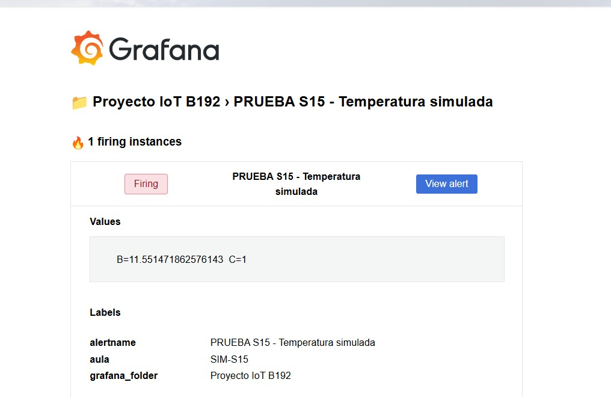

En la **figura 13** se observa la notificación recibida desde Grafana. La regla pasó por su período de evaluación y posteriormente envió el aviso, confirmando el funcionamiento del contacto de Gmail.

## 6. Resultados y análisis

Se consolidó un dashboard que reúne los registros históricos de los sensores, indicadores del estado actual, tendencias y estadísticas diarias. El selector permite consultar los registros identificados como AULA-101 y AULA-102 desde una misma pantalla, mientras que la comparación conserva ambas series.

El Gauge facilita reconocer si la temperatura está lejos, cerca o por encima del umbral estadístico. Por otra parte, la simulación con **40 °C** permitió comprobar la escritura de datos de prueba, la activación de una regla en Grafana y la recepción de una notificación por Gmail.

La integración se mantuvo sin sustituir los componentes anteriores: **Adafruit IO recibe, Python sincroniza, InfluxDB almacena y Grafana visualiza y genera las alertas**.

## 7. Dificultades y limitaciones

Durante las pruebas aparecieron lecturas iniciales atípicas que deben revisarse al interpretar los promedios. También se observó que, si Python deja de generar cálculos recientes, el Gauge puede mostrar *No data* aunque los registros históricos permanezcan guardados.

Las dos series de la comparación se registraron con un mismo prototipo en sesiones distintas; **no se debe afirmar una comparación simultánea entre dos aulas físicas** sin evidencia de haber medido ambos lugares. Si falla el WiFi, el ESP32 no dispone actualmente de un almacenamiento local completo de respaldo, por lo que pueden quedar huecos en los registros. Se recomienda mantener esos intervalos visibles en lugar de inventar mediciones.

La luminosidad se expresa mediante el valor **ADC** del LDR, no en lux calibrados. En el caso del aforo, el conteo depende de las detecciones realizadas por los sensores infrarrojos.

## 8. Organización del código y evidencias

```text
proyecto-iot-semana15/
├── README.md
├── codigo/
│   └── README.md                 # Aquí se añade el código del ESP32 usado en el proyecto
├── scripts/
│   └── simulacion_s15.py         # Simulación controlada de 40 °C
├── dashboards/
│   ├── README.md
│   └── dashboard_grafana.json    # Exportación de Grafana: agregar el JSON real
├── docs/
│   └── 01_adafruit ... 13_correo # Las 13 capturas explicadas en este README
└── .gitignore
```

La carpeta **`codigo/`** está preparada para incluir el programa del ESP32 que se utilizó en el montaje. El funcionamiento principal de la ingesta y del cálculo histórico sigue documentado en el proyecto de [**semana 14**](../proyecto-iot-semana14/), donde se encuentran `ingesta.py`, `comun.py`, `ejecutar.py`, `alertas.py`, `compose.yaml` y los archivos de configuración del servidor.

El archivo `dashboards/dashboard_grafana.json` debe corresponder a la **exportación final** del dashboard de Grafana, con los paneles y la variable de aula guardados. Las reglas de alertas se administran por separado en Grafana y no deben darse por exportadas automáticamente dentro de ese JSON.

**Seguridad:** no publicar el `.env`, `config.h` con credenciales reales, tokens, contraseñas de WiFi o Gmail, ni datos personales sensibles en capturas.

## 9. Cómo volver a iniciar el proyecto existente

No es necesario reinstalar las herramientas para volver a utilizar el proyecto. Con el ESP32 conectado y Docker Desktop abierto, desde la carpeta **operativa de semana 14** que contiene `compose.yaml`, ejecutamos:

```powershell
docker compose up -d
docker compose ps
```

Después iniciamos la sincronización:

```powershell
.\.venv\Scripts\python.exe scripts\ejecutar.py
```

Se puede consultar **InfluxDB** en `http://localhost:8086`, **Grafana** en `http://localhost:3000` y los feeds en [Adafruit IO](https://io.adafruit.com/). Para detener, se presiona `Ctrl + C` en Python y luego se ejecuta `docker compose stop`. No se utiliza `docker compose down -v`, porque eliminaría los volúmenes persistentes.

## 10. Preguntas de reflexión para la sustentación

**1. ¿Por qué utilizar promedios y máximos antes de visualizar todas las mediciones?**  
Porque resumen las lecturas, permiten identificar tendencias y hacen que Grafana procese menos puntos, mejorando el rendimiento del dashboard.

**2. ¿Qué ventajas tiene un umbral dinámico frente a uno fijo?**  
Se ajusta al comportamiento histórico del aula y ayuda a identificar cambios que podrían ser normales en un horario, pero anormales en otro. Su eficacia también depende de contar con suficientes datos representativos.

**3. ¿Cuándo conviene Grafana y cuándo Looker Studio?**  
Grafana resulta adecuado para visualizar datos de InfluxDB y administrar alertas en el servidor local. Looker Studio facilita compartir reportes en la nube, pero tiene otras dependencias y menos posibilidades de alertas integradas para este caso.

**4. ¿Qué haríamos si el proyecto pasara de dos a cincuenta aulas?**  
Utilizaríamos variables y plantillas para seleccionar las aulas, filtros y paneles reutilizables, evitando un dashboard independiente por cada salón.

**5. ¿Cómo se deben mostrar los períodos en los que falla el WiFi?**  
Preferimos dejar huecos visibles en las gráficas, porque interpolar o repetir el último valor puede dar la impresión de que se midió algo que no se registró. Si se estiman valores, se deben identificar claramente como aproximaciones.

## 11. Conclusiones

Con la semana 15 se aprovechó el almacenamiento de InfluxDB para visualizar el comportamiento histórico en Grafana de una forma más organizada. El dashboard incluye las variables del aula, las tendencias de temperatura y luminosidad, la tabla de agregaciones diarias, una comparación de sesiones y un Gauge de estado dinámico.

También se comprobó el sistema de notificaciones mediante una simulación de temperatura alta almacenada de manera independiente. El proyecto conserva el flujo entre ESP32, Adafruit IO, Python, InfluxDB y Grafana, y ahora facilita el análisis de la información para identificar cambios y posibles condiciones anormales.

## 12. Referencias

- Adafruit. (s. f.). *Adafruit IO API Reference*. https://io.adafruit.com/api/docs/
- Grafana Labs. (s. f.). *Grafana documentation*. https://grafana.com/docs/grafana/latest/
- InfluxData. (s. f.). *InfluxDB 2 documentation*. https://docs.influxdata.com/influxdb/v2/
- Montero Ojeda, E. (2026). *Presentación Semana 15: Visualización Histórica Avanzada y Cierre del Proyecto Integrador IoT*. Unidades Tecnológicas de Santander.
