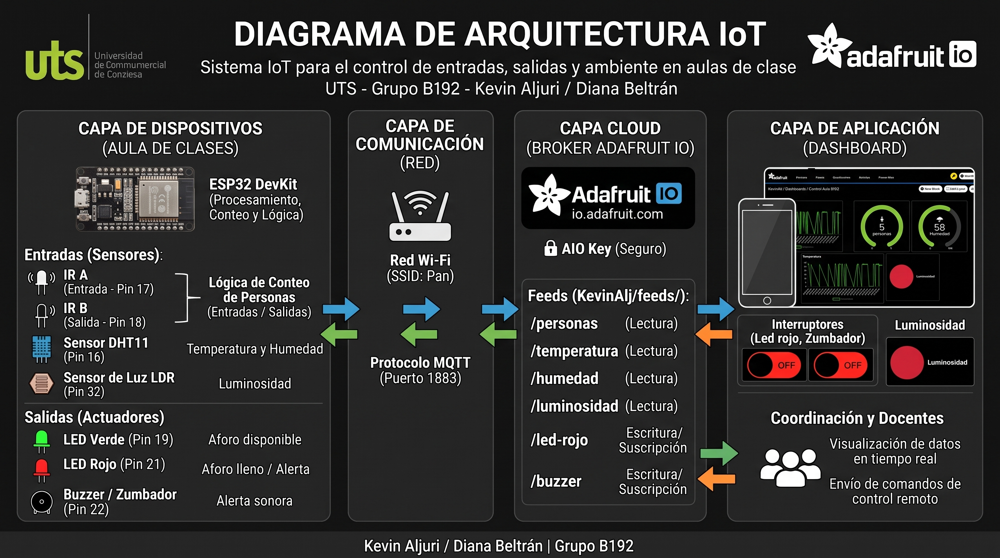
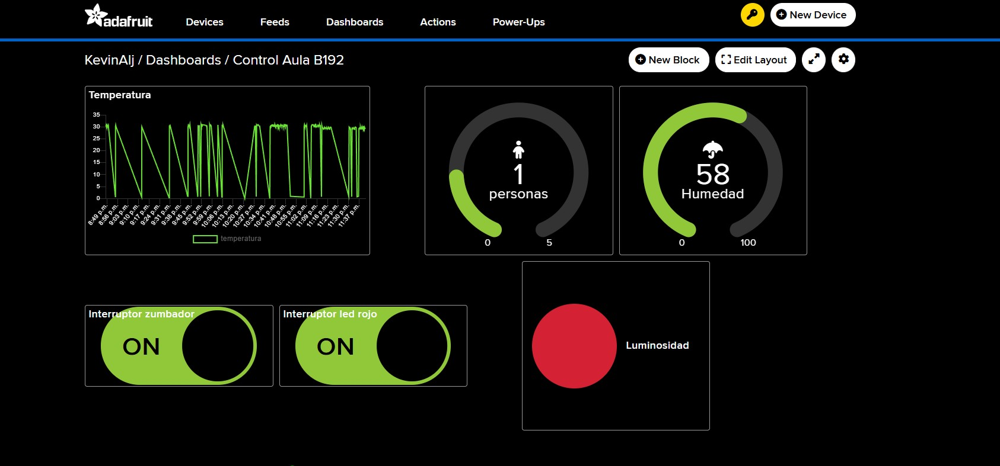

# Sistema IoT para el control de entradas y salidas en aulas

**Integrantes:** Kevin Aljuri y Diana Beltran  
**Grupo:** B192 — UTS

## 1. Descripción del proyecto

Sistema IoT desarrollado con una ESP32 para contar las entradas y salidas de personas en un aula, medir la temperatura, humedad y luminosidad, y controlar actuadores de forma remota mediante Adafruit IO.

## 2. Diagrama de arquitectura

La ESP32 recibe información de los sensores y publica los datos en Adafruit IO mediante Wi-Fi y MQTT. El dashboard permite visualizar las mediciones y controlar el LED rojo y el buzzer.

## 3. Capturas del dashboard

### Datos de los sensores

## 4. Instrucciones para replicar el proyecto

1. Instalar el IDE de Arduino.
2. Instalar las bibliotecas `PubSubClient` y `DHT sensor library`.
3. Conectar los sensores y actuadores a la ESP32 según los pines definidos en el código.
4. Crear una cuenta en Adafruit IO y configurar los feeds `personas`, `temperatura`, `humedad`, `luminosidad`, `led-rojo` y `buzzer`.
5. Crear el archivo `config.h` con las credenciales de Wi-Fi y Adafruit IO.
6. Cargar el código en la ESP32 y comprobar la conexión a Wi-Fi y Adafruit IO.
7. Abrir el dashboard, verificar la recepción de datos y probar los controles del LED rojo y el buzzer.

**Seguridad:** No subir contraseñas de Wi-Fi ni claves de Adafruit IO a GitHub.
